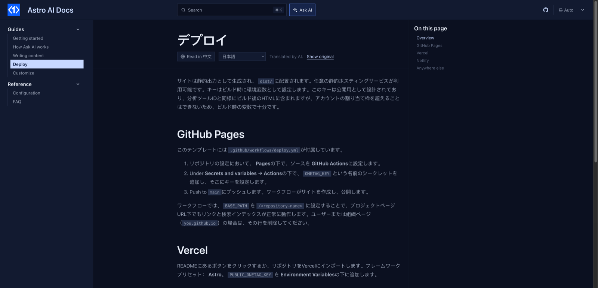

# starlight-onetag-translate

Let readers read your [Starlight](https://starlight.astro.build) docs in their own language. A **Read in 中文** (or Español, 日本語…) button under the page title translates the page with AI, in the browser, in a few seconds. You keep writing in one language; there are no translation files to maintain.



- The button offers the reader's browser language; a menu lists 16 more.
- Code blocks, inline code, commands and URLs are left untouched; links and formatting stay in place.
- The choice is remembered, so the next pages open already translated. **Show original** switches back.
- Translations are cached in the reader's browser, so a page is translated once per reader.

Live demo: the [Astro AI Docs](https://fengyiqicoder.github.io/astro-ai-docs/) template runs every starlight-onetag plugin.

## Install

```bash
npm install starlight-onetag
```

This plugin ships inside the [`starlight-onetag`](https://www.npmjs.com/package/starlight-onetag) package (0.2.0 and later) as `starlight-onetag/translate`. This repository holds its source and docs.

```js
// astro.config.mjs
import { defineConfig } from "astro/config";
import starlight from "@astrojs/starlight";
import starlightOnetagTranslate from "starlight-onetag/translate";

export default defineConfig({
  integrations: [
    starlight({
      title: "My docs",
      plugins: [starlightOnetagTranslate()],
    }),
  ],
});
```

## Before you deploy: get a free key

On localhost it works without a key, on a shared demo key. A deployed site needs its own: pass it as `starlightOnetagTranslate({ key: "ot_..." })` or set `PUBLIC_ONETAG_KEY` in `.env`. Without one, readers see a line saying AI is not set up, and the build prints a warning.

Fill in your email at [onetagai.com](https://onetagai.com/?ref=starlight-onetag-translate), or run this; the key arrives in that inbox (one key per email, 1,000,000 free tokens a month):

```bash
curl -X POST https://onetagai.com/api/signup -H "Content-Type: application/json" -d '{"email":"you@example.com"}'
```

The key is designed to be public, like an analytics ID: it ends up in the built HTML and can only spend that account's allowance. One key works for every starlight-onetag plugin on the site.

## Options

| Option | Default | What it does |
| --- | --- | --- |
| `key` | `""` (or `PUBLIC_ONETAG_KEY`) | The OneTag AI key. |
| `languages` | 16 common languages | Language codes offered in the menu. |
| `remember` | `true` | Translate the next pages into the language the reader picked. |
| `cache` | `true` | Keep translations in the reader's browser. |
| `batchChars` | `3500` | Characters sent per request; long pages are translated in several. |
| `maxTokens` | `4000` | Answer length cap per request. |
| `site` | `https://onetagai.com` | Where the API lives, for self-hosted deployments. |

## How it works

1. The text of the title and the docs content is collected in reading order, skipping code, `translate="no"` and `.notranslate`.
2. It goes to OneTag AI in numbered batches; each answer replaces the text nodes it belongs to, so links, bold and inline code keep their place.
3. Nothing in the page is replaced as HTML: translated text is set as text only.

The plugin adds no component overrides, so it works next to any other Starlight plugin or custom component. The AI code is a separate chunk loaded the first time a reader uses the feature; page speed stays where it was. Nothing is stored on a server: OneTag AI keeps token counts and timestamps, not page text or questions.

## More AI for Starlight

- [starlight-onetag](https://github.com/fengyiqicoder/starlight-onetag): Ask AI dialog next to the search box, answered from your pages
- [starlight-onetag-search](https://github.com/fengyiqicoder/starlight-onetag-search): AI answer inside the search dialog, above the Pagefind results
- [starlight-onetag-explain](https://github.com/fengyiqicoder/starlight-onetag-explain): "Explain this code" under every code block
- [starlight-onetag-summary](https://github.com/fengyiqicoder/starlight-onetag-summary): "Summarize this page" box at the top of long pages
- [starlight-onetag-selection](https://github.com/fengyiqicoder/starlight-onetag-selection): select any text, click Ask AI, get it explained in context

## License

MIT. Powered by [OneTag AI](https://onetagai.com/?ref=starlight-onetag-translate).
